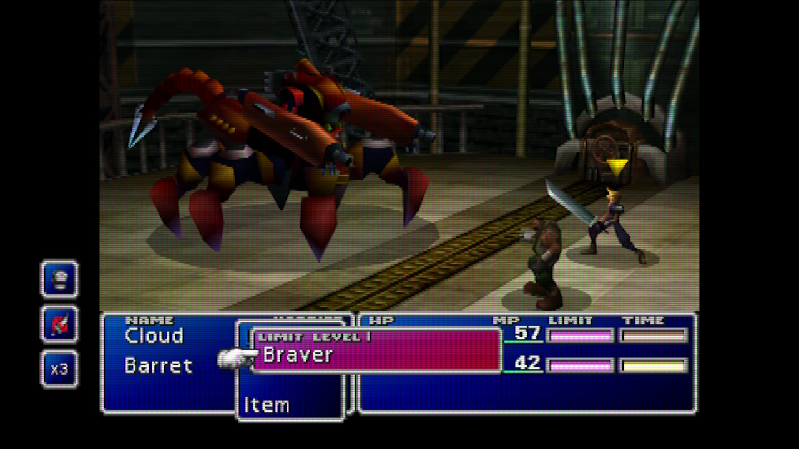

# FF7 Switch shaders

Plugin that runs OpenGL shaders over FINAL FANTASY VII on Nintendo Switch.

# Features
Includes crt-geom and crt-easymode. L+ZL to enable the menu.

Optional addons: custom cheat icons __(3x speed, no encounters, battle boost)__ that match the game's UI style. "Crisp" shaders that restore the pixel perfect look similar to the PC port. Delete the romfs folder if you don't want them.

# Instructions
Extract release.zip and you'll find **exefs** and **romfs**.

Drop them in `sdmc:/atmosphere/contents/TitleID`

## Credits

- [OpenGL implementation of libretro shaders](https://github.com/libretro/glsl-shaders)
- [exlaunch](https://github.com/shadowninja108/exlaunch) created by shadowninja108.
- [ImGui](https://github.com/ocornut/imgui) by ocornut.
- Pixel perfect shaders from [7th Heaven NX](https://github.com/ppkantorski/7th-Heaven-NX)
